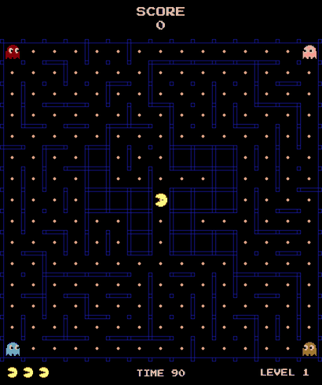
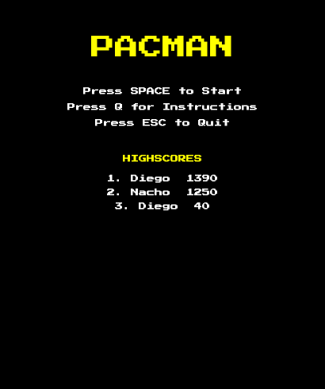
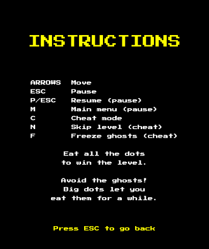
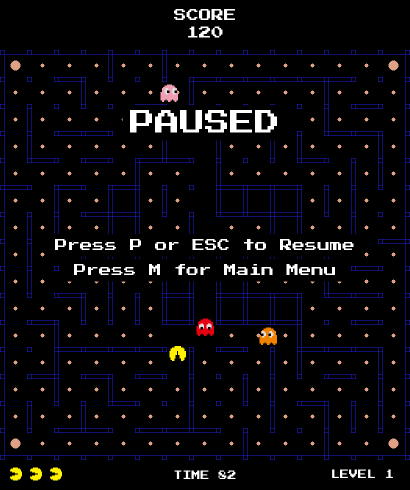
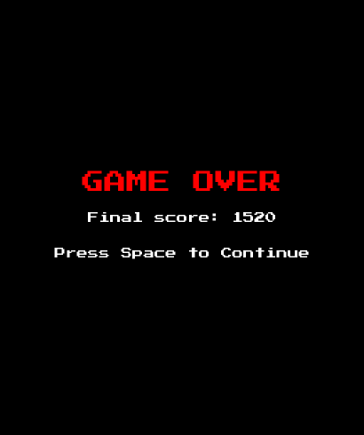
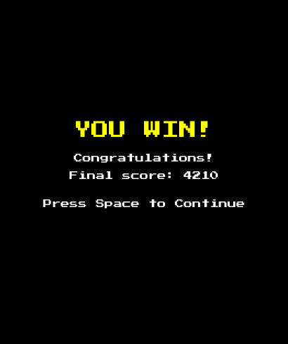
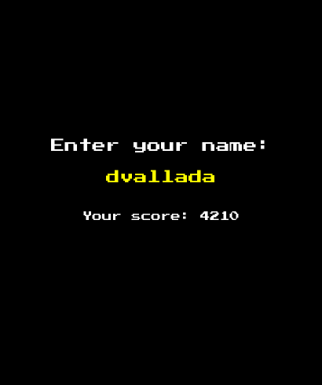
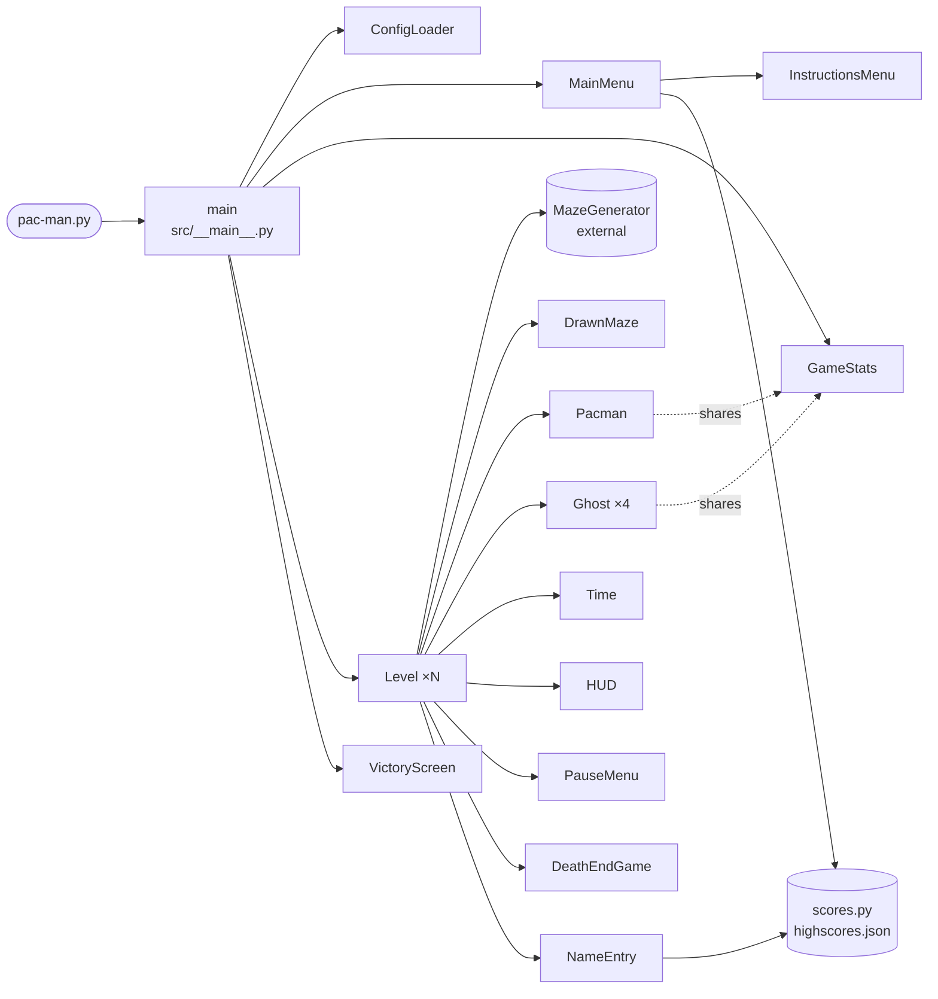

*This project has been created as part of the 42 curriculum by imelero-, dvallada.*

<div align="center">

&nbsp;&nbsp;


# PAC-MAN

**Ghosts! More ghosts!**<br>
A remake of the 1980 arcade classic in Python and pygame, with mazes made by an
external generator, four ghosts with their own personality and a persistent
top 10.




[Description](#description) •
[Instructions](#instructions) •
[Configuration](#configuration) •
[Highscore](#highscore) •
[Maze Generation](#maze-generation) •
[Implementation](#implementation) •
[Architecture](#general-software-architecture) •
[Project Management](#project-management) •
[Resources](#resources)

</div>

---

## Description

Eat every pacgum of the maze to clear the level while four ghosts chase you.
Eat a **super-pacgum** in a corner and, for a few seconds, the hunters become
the hunted.

The goal of the project is a complete, playable game with a clean
object-oriented architecture:

| | Feature |
|:-:|---|
| 🧩 | **10+ levels**, each one a maze built by an external *A-Maze-ing* package (made by another group, used as-is) |
| 👻 | **4 ghosts with different strategies** (chase, ambush, flank…) that find their way with BFS |
| ⚙️ | **JSON configuration** with `#` comments: lives, points, time limit, seed and the size of every level |
| 🛡️ | **No crash, no traceback**: invalid config values fall back to safe defaults with a warning |
| 🏆 | **Persistent top 10** of highscores, shown in the main menu |
| 🔁 | **Full game loop**: main menu → levels → game over or victory → name entry → main menu |
| ⏸️ | **Pause**, in-game **instructions** and a **cheat mode** for the peer review |

<table>
  <tr>
    <td align="center"><br><sub>Main menu and top 10</sub></td>
    <td align="center"><br><sub>Instructions</sub></td>
    <td align="center"><br><sub>Pause menu</sub></td>
  </tr>
  <tr>
    <td align="center"><br><sub>Game over</sub></td>
    <td align="center"><br><sub>Victory</sub></td>
    <td align="center"><br><sub>Name entry for the highscores</sub></td>
  </tr>
</table>

---

## Instructions

### Requirements

- **Python 3.12** or later
- **[uv](https://docs.astral.sh/uv/)**, which installs pygame and the maze
  generator in a virtual environment

### Install and run

```bash
make install        # uv sync: creates .venv with every dependency
make run            # python pac-man.py config.json
```

Or, inside the virtual environment, with any config file:

```bash
uv run python pac-man.py config.json
```

The program takes **exactly one argument**, the configuration file (a
`.json` file). A wrong number of arguments, a missing file or invalid JSON
stop the program with a clear error message.

### Controls

| Where | Keys | Action |
|---|---|---|
| Main menu | <kbd>Space</kbd> | Start a new game |
| | <kbd>Q</kbd> | Instructions |
| | <kbd>Esc</kbd> | Quit |
| In game | <kbd>←</kbd> <kbd>↑</kbd> <kbd>↓</kbd> <kbd>→</kbd> | Move |
| | <kbd>Esc</kbd> | Pause |
| Pause | <kbd>P</kbd> / <kbd>Esc</kbd> | Resume |
| | <kbd>M</kbd> | Back to the main menu (the game is lost, no score saved) |
| Game over / Victory | <kbd>Space</kbd> | Continue to the name entry |
| Name entry | letters, digits, space | Type your name (max 10 characters) |
| | <kbd>Enter</kbd> | Save the score |

### 🕹️ Cheat mode (for the peer review)

| Keys | Action |
|---|---|
| <kbd>C</kbd> | Turn cheat mode **on / off**. While it is on you are **invincible**: neither the ghosts nor the time limit can kill you. `CHEAT` is shown at the top left. |
| <kbd>N</kbd> | *(cheat mode)* **Skip the level**: it is cleared at once. Press it 10 times to see the victory screen. |
| <kbd>F</kbd> | *(cheat mode)* **Freeze / unfreeze the ghosts**. `FROZEN` is shown under `CHEAT`. |

Cheat mode stays on from one level to the next until it is turned off.

### Other Makefile rules

| Rule | Does |
|---|---|
| `make debug` | Runs the game under `pdb` |
| `make lint` | `flake8 .` and `mypy .` with the flags required by the subject |
| `make lint-strict` | `flake8 .` and `mypy . --strict` |
| `make clean` | Removes `__pycache__` and the mypy cache |

---

## Configuration

The configuration file is standard JSON plus **comments**: every line whose
first non-blank character is `#` is ignored. The file must contain one JSON
object.

<details>
<summary><b>Example configuration</b></summary>

```json
# Pac-Man configuration
# Lines starting with # are ignored
{
    "highscore_filename": "highscores.json",
    "lives": 3,
    "points_per_pacgum": 10,
    "points_per_super_pacgum": 50,
    "points_per_ghost": 200,
    "seed": 42,
    "level_max_time": 90,

    # One entry per level: maze size of each level
    "levels": [
        {"width": 10, "height": 10},
        {"width": 12, "height": 10},
        {"width": 12, "height": 12},
        {"width": 15, "height": 12},
        {"width": 15, "height": 15},
        {"width": 8, "height": 10},
        {"width": 16, "height": 10},
        {"width": 12, "height": 14},
        {"width": 13, "height": 17},
        {"width": 20, "height": 20}
    ]
}
```

</details>

| Key | Type | Default | Meaning / rules |
|---|---|---|---|
| `highscore_filename` | non-empty string | `"highscores.json"` | File where the top 10 is stored |
| `lives` | integer ≥ 1 | `3` | Lives at the start of a game |
| `points_per_pacgum` | integer ≥ 0 | `10` | Points for a pacgum |
| `points_per_super_pacgum` | integer ≥ 0 | `50` | Points for a super-pacgum (corners) |
| `points_per_ghost` | integer ≥ 0 | `200` | Points for eating a ghost |
| `seed` | integer ≥ 0 | `42` | Seed of the **first** level's maze; the next levels are random. `0` makes level 1 random too |
| `level_max_time` | integer ≥ 1 | `90` | Time limit of each level, in seconds |
| `levels` | list of `{"width", "height"}` | 10 levels of 15×15 | One maze per level; width and height go from 5 to 20 |

> [!NOTE]
> **Faulty values never stop the game.** A missing key, a value of the wrong
> type or a value out of range is replaced by its default (or clamped to the
> allowed range) and a warning is printed. Unknown keys are ignored. A level
> that is not an object is skipped, and if fewer than **10** valid levels
> remain, default 15×15 levels are added until there are 10.

```text
[config] Warning: 'lives' must be an integer, using 3
[config] Warning: 'levels[9].height' is above 20, using 20
[config] Warning: only 2 valid levels, adding 8 default levels (15x15)
```

**Time limit.** When the time of a level runs out, the player loses a life, as
if caught by a ghost, and the level timer starts again.

**Window size.** Every maze cell is 54 px and the window grows with the
largest level of the config (minimum 640×900, so that the menus fit). A 20×20
maze needs a screen at least 1250 px tall; use smaller levels on smaller
screens.

---

## Highscore

- 🗂️ The top 10 is stored in a **JSON file** inside the project (by default
  `highscores.json`, set with `highscore_filename`), as a list of
  `{"name": ..., "score": ...}` objects.
- 📥 It is **loaded** every time the main menu opens, so a score saved at the
  end of a game appears straight away, and 📤 **saved** after the name entry
  that follows a game over or a victory.
- 🔢 When saving, the new score is added, the list is sorted from best to
  worst and only the best 10 are kept.
- ✏️ **Names**: 1 to 10 characters, only letters, digits and spaces (the name
  entry does not accept anything else). **Scores**: non-negative integers.
- 🛡️ **Robust to file errors**: a missing, empty, unreadable or invalid file
  is read as an empty top 10. Inside a valid file, every entry that breaks
  the rules above (name too long, negative score, `true` as score, missing
  key…) is skipped. If the file cannot be written, a warning is printed and
  the game goes on.

**Why this way?** JSON is readable and easy to edit by hand (handy to test the
validation during the peer review), Python reads and writes it with the
standard library, and a 10-entry file is small enough to be read and rewritten
whole every time. Validating on every load means a file edited by hand can
never break the menu.

---

## Maze Generation

The mazes come from the *A-Maze-ing* package assigned to us,
**`mazegenerator` 2.1.0**, made by another group. It is used **as-is**: the
wheel is in the repository (`mazegenerator-2.1.0-py3-none-any.whl`) and uv
installs it as a dependency (`[tool.uv.sources]` in `pyproject.toml`).

For each level, `Level` creates the maze like this:

```python
MazeGenerator(size=(width, height), perfect=False,
              entry_cell=(0, 0), exit_cell=(-1, -1), seed=seed)
```

- `perfect=False` makes a maze with loops and no dead ends, so the ghosts
  cannot trap the player.
- `seed` is the config seed for level 1 and `0` (random, for this package)
  for the next levels.
- The result, `maze_obj.maze`, is a list of rows, `maze[row][col]`, where each
  cell is a 4-bit number of walls:

  | Bit | `1` | `2` | `4` | `8` |
  |---|:-:|:-:|:-:|:-:|
  | Wall | up | right | down | left |

  `DrawnMaze` turns those bits into wall lines and collision rects, and the
  ghosts use them to find their path.

Our loader adapts to this interface:

- The package draws a **"42" of closed cells** (value `15`) in the center of
  big enough mazes. Pacgums are not placed there, and Pac-Man starts on the
  free cell closest to the center instead of the exact center.
- If the generator raises an error, the game stops with a clear message
  (`Error: maze generator failed for level N: ...`), never a traceback.
- The package has no type information, so `pyproject.toml` tells mypy not to
  check it.

---

## Implementation

**Game loop** (`src/__main__.py`) — reads the config, opens the window and
loads the assets, then loops: main menu → one `Level` per config entry →
victory screen if every level is cleared → name entry → main menu. A
`for ... else` shows the victory only when no level ended the game early.

**Level** (`src/level.py`) — generates the maze, creates Pac-Man and the 4
ghosts and runs the frame loop at 60 FPS: events (pause, cheats), time limit,
movement, collisions, drawing. It returns `"cleared"`, `"menu"`,
`"score saved"` or `"quit"`, so the game loop knows what to do next.

**Shared game state** (`GameStats`) — score, lives and cheat flags live in one
object created per game and passed to every level, so they are kept between
levels.

**Pac-Man** (`src/pacman.py`) — moves on a grid of 54 px cells. A new
direction is only taken when Pac-Man is aligned with the corridor; walls are
checked with rect collisions. Eating a corner pacgum makes the ghosts flee.

**Ghosts** (`src/ghosts.py`) — a breadth-first search on the maze cells gives
the first move of the shortest path to a target cell. The target depends on
the colour:

| | Ghost | Target cell |
|:-:|---|---|
|  | **Red** | Pac-Man's cell: it chases him |
|  | **Pink** | 4 cells in front of Pac-Man: it ambushes him |
|  | **Orange** | 4 cells behind Pac-Man |
|  | **Blue** | The red ghost mirrored over the cell 2 in front of Pac-Man: with red, it surrounds him |
|  | **Frightened** | After a super-pacgum: runs slowly to its corner for 6 s (blinking in the last 2.25 s). Once eaten, it goes back to its corner and chases again after 6 s |

**Death and respawn** — a ghost touching Pac-Man (or the time running out)
starts a 1.2 s death animation; then a life is lost and everybody goes back
to the start, or the Game Over screen appears if it was the last life.

**Errors** — config, assets, maze generator and highscore file errors are all
caught and turned into clear messages or warnings. Asset paths are built from
the location of the code (`src/paths.py`), so the game can be launched from
any folder.

**Code quality** — type hints and docstrings everywhere; `flake8 .` and
`mypy . --strict` pass without errors.

---

## General Software Architecture



| Module | Main class / role |
|---|---|
| `pac-man.py` | Entry point required by the subject; calls `main()` |
| `src/__main__.py` | Game loop between menu, levels and end screens |
| `src/parse_entry.py` | `ConfigLoader` (reads and validates the config), `LevelConfig`, `ConfigError` |
| `src/level.py` | `Level`: one playable level and its frame loop; `LevelError` |
| `src/game_stats.py` | `GameStats`: score, lives and cheat flags of the current game |
| `src/draw_maze.py` | `DrawnMaze`: draws walls and pacgums, wall rects, `win_check` |
| `src/pacman.py` | `Pacman`: movement, eating, death animation, respawn |
| `src/ghosts.py` | `Ghost`: chase / flee / eaten behaviours, BFS path finding |
| `src/level_time.py` | `Time`: level timer that ignores the time spent in pause |
| `src/hud.py` | `HUD`: score, lives, level, time and cheat indicators |
| `src/main_menu.py`, `src/instructions_menu.py` | Menus |
| `src/pause_menu.py`, `src/death_end_game.py`, `src/victory_screen.py`, `src/name_entry.py` | Pause and end-of-game screens |
| `src/scores.py` | Load, validate and save the highscores |
| `src/paths.py` | Absolute paths of the assets |

**Relationships.** `main()` owns the long-lived objects (window, screens,
config) and creates a new `GameStats` per game and a new `Level` per level.
Each `Level` owns its maze, its `Pacman` and its 4 `Ghost` objects; Pac-Man
and the ghosts share the `GameStats` of the game (score, lives, cheats) and
the wall rects of the `DrawnMaze`. Every screen has the same shape: a `draw()`
method and a `run()` loop that returns a string telling the caller what the
player chose.

---

## Project Management

TODO: short overview of how the project was managed (method, tools, how the
work was split, how decisions were taken), with a link to the project
management folder, e.g. [`project_management/`](project_management/).

---

## Resources

- 📘 [pygame documentation](https://www.pygame.org/docs/) — display, events,
  drawing, fonts and sprites.
- 👻 [The Pac-Man Dossier](https://pacman.holenet.info/) and
  [Understanding Pac-Man Ghost Behavior](https://gameinternals.com/understanding-pac-man-ghost-behavior)
  — how the original ghosts choose their target (chase, ambush, flank).
- 🧭 [Breadth-first search (Wikipedia)](https://en.wikipedia.org/wiki/Breadth-first_search)
  — the ghosts' path finding.
- 🧹 [PEP 8](https://peps.python.org/pep-0008/) and
  [PEP 257](https://peps.python.org/pep-0257/) — code style and docstrings;
  [flake8](https://flake8.pycqa.org/) and [mypy](https://mypy.readthedocs.io/)
  documentation.
- 📦 [uv documentation](https://docs.astral.sh/uv/) — dependencies and virtual
  environment.
- 🔤 Font: [Press Start 2P](https://fonts.google.com/specimen/Press+Start+2P)
  (SIL Open Font License).
- 🎨 Sprites: TODO (where `assets/sprites.png` comes from).

### 🤖 Use of AI

AI was used as an assistant for debugging, reviewing and polishing, always
reviewing and testing what it proposed:

- **Debugging the move to multiple levels:** finding the cause of an
  `IndexError` in the blue ghost target (rows and columns mixed up in
  non-square mazes).
- **Proposing fixes** that we reviewed one by one before applying: keeping
  score and lives between levels (`GameStats`), victory screen, time limit,
  pause → main menu, cheat keys, asset paths, highscore validation.
- **Code quality:** making `flake8` and `mypy --strict` pass, and writing
  type hints and docstrings, checking with frame-by-frame comparisons that
  the game behaviour did not change.
- **Writing a first draft of this README**, then completed and checked by
  us.

<div align="center">
<br>


<br><sub>Waka-waka!</sub>
</div>
