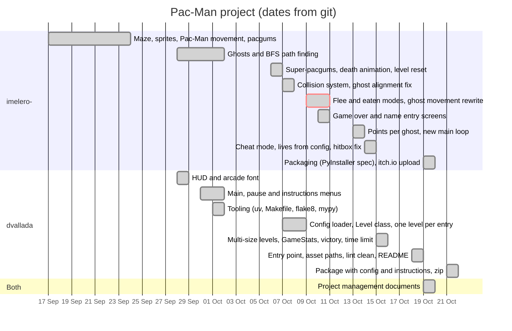

# Timeline and progress tracking

Source of truth for the real dates: the git history of the repository
(68 commits, 17 Sep - 18 Oct 2026, branches `main`, `ghosts-flee`, `nacho`,
`screens` and `final-fixes`). Check with `git log --date=short`.

## Tools

- **Git / GitHub** (`nachom9/pacman`): one branch per area of work at the
  beginning (`ghosts-flee`, `screens`, `nacho`), merged into `main`.
  `screens` was deleted on 19 Oct once merged; the last fixes are done in
  `final-fixes` so that `main` is only updated with finished work.

## Gantt chart

Each bar is one phase of the table below, from its first to its last day in
git, grouped by the member who mainly did it.

The red bar is the ghost movement rewrite, the main blocker of the project
(`blockers.md`, section 1).

## What was done and when

| # | Phase | Dates (git) | Mainly done by |
|---|-------|-------------|----------------|
| 1 | Maze drawing, sprites, Pac-Man movement, pacgums | 17-23 Sep | imelero- |
| 2 | HUD: score, lives, level, time, arcade font | 28 Sep | dvallada |
| 3 | Ghost objects and BFS path finding; red, pink, orange and blue behaviours | 28 Sep - 1 Oct | imelero- |
| 4 | Main menu, pause menu, instructions screen, highscores in the menu, pause freezes the level timer | 30 Sep - 1 Oct | dvallada |
| 5 | Tooling: uv, Makefile, flake8 and mypy; merge of ghosts and screens | 1 Oct | dvallada |
| 6 | Super-pacgums, death animation, level reset, first ghost flee mode | 6 Oct | imelero- |
| 7 | Config loader with validation; game loop moved into `Level`; one level per config entry; clean error when the maze generator fails | 7-8 Oct | dvallada |
| 8 | New collision system and first alignment fix for ghosts | 7 Oct | imelero- |
| 9 | Flee / eaten modes and rewrite of ghost movement (the main bug, see `blockers.md`) | 9-10 Oct | imelero- |
| 10 | Game over screen and name entry screen | 10 Oct | imelero- |
| 11 | Points per ghost from the config, new main loop, back to the menu after saving | 13 Oct | imelero- |
| 12 | Cheat mode, lives from the config, pacgum hitbox, wall corner fix | 14 Oct | imelero- |
| 13 | Levels of different sizes, spawn outside the "42", `GameStats` (score and lives kept between levels), victory screen, death when the time ends, cheat actions, minimum window size, real top 10 in the menu, highscore validation | 15 Oct | dvallada |
| 14 | Entry point `pac-man.py`, asset paths independent of the working directory, pause -> main menu, final score on game over, `flake8` and `mypy --strict` clean, README | 18 Oct | dvallada |
| 15 | Project management documents | 19 Oct | both |
| 16 | Packaging with PyInstaller (`Pacman.spec`, `make package`) and upload to itch.io as a free, password-protected build | 19 Oct | imelero- |
| 17 | Package fixes: `config.json` and `HOW_TO_PLAY.txt` inside the package, zip for the upload, no prompt when it is rebuilt | 21 Oct | dvallada |

## Milestones

We did not set deadlines in advance. We worked feature by feature, using
the subject as a checklist, and agreed on the next steps in our meetings.
The table shows when each milestone was actually reached, according to git.

| Milestone | Reached |
|-----------|---------|
| Playable maze with Pac-Man and ghosts | 1 Oct |
| Config file and several levels | 7 Oct |
| Highscores, game over, name entry, loop back to the menu | 13 Oct |
| Cheat mode | 14-15 Oct |
| Victory screen, time limit, lint clean | 15-18 Oct |
| Packaging and deployment | 19-21 Oct |

What the history shows:

- Most features were in place by 15 Oct; 18 Oct was spent on robustness,
  type hints and documentation.
- The hardest problem was the ghost movement at different speeds. It took
  from 7 Oct (first patch) to 9 Oct (rewrite) and was the only one that
  forced a redesign instead of a fix.
- Supporting levels of different sizes (15 Oct) exposed bugs that had been
  hidden while every maze was 15x15 (see `blockers.md`).

## Open items on 21 Oct

| Item | Why it matters |
|------|----------------|
| Upload the new `Pacman-linux.zip` to itch.io and remove the old file | The first upload was made before `config.json` and `HOW_TO_PLAY.txt` were added to the package |
| Peer-review preparation: everyone must be able to explain every module (recode exercise) | See `risks.md` |
